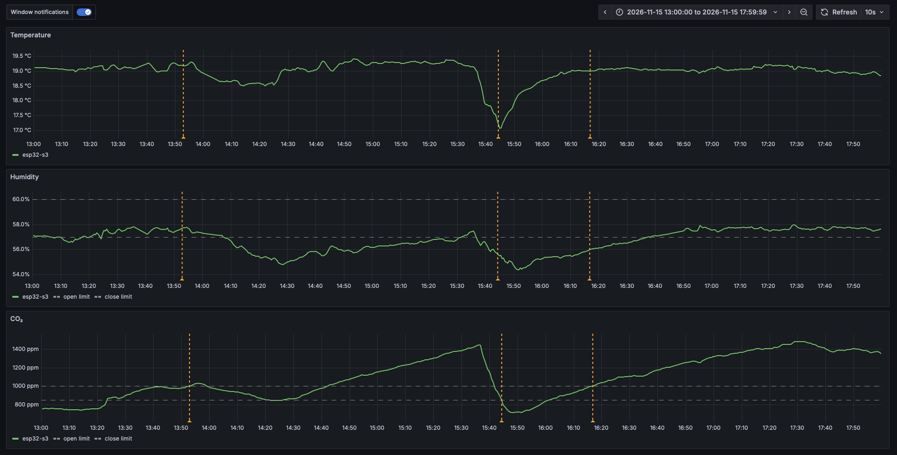
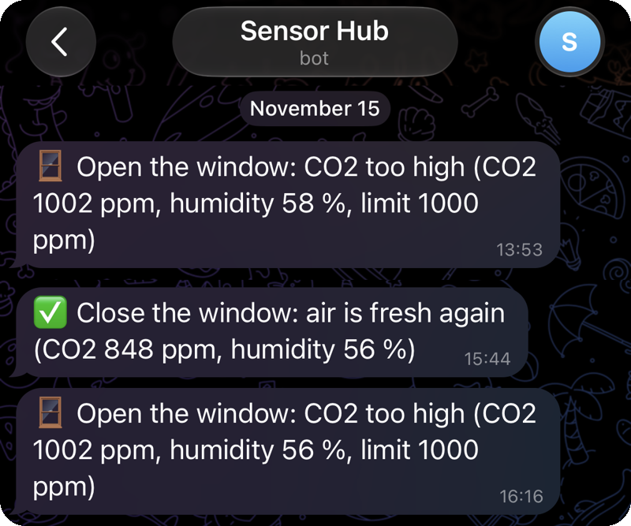
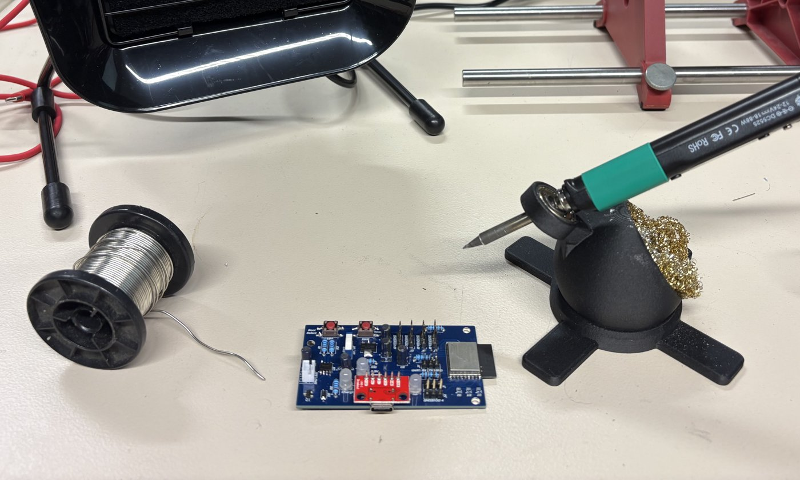

# Sensor Hub — ESP32 · FastAPI · Postgres · Docker

[](https://github.com/m-hoelper/sensor-hub/actions/workflows/ci.yml)

An indoor air-quality monitor for my room. An **ESP32-S3 with a Sensirion SCD40** measures CO₂, temperature and humidity, buffers every reading in flash and uploads it to a **FastAPI backend**. The backend stores the data in **Postgres**, shows it in **Grafana**, and sends a **Telegram message** when the window should be opened or closed. The whole backend starts with one `docker compose up`.

Personal project (November 2026), built end to end: firmware in C++ (Arduino on ESP32), backend in Python, deployment with Docker Compose.

**How it was built:** I wrote the backend and firmware code myself, with an AI assistant (Claude) as tutor and reviewer. The test suite, the Telegram sender, the Grafana dashboard, the Docker setup and this documentation were written with the assistant and reviewed by me.

**Highlights:**
- **No data loss when the backend is offline.** The ESP32 keeps up to one week of readings in a ring buffer on its flash and uploads the backlog in batches when the server is reachable again.
- **Idempotent batch upload.** Each reading is unique per `(device_id, created_at)`. A resent batch after a lost response inserts nothing twice (`INSERT … ON CONFLICT DO NOTHING RETURNING`).
- **Reliable notifications with an outbox.** The window rule writes a notification row in the same transaction as the measurements. A separate worker sends it to Telegram, with retries and `SELECT … FOR UPDATE SKIP LOCKED`.
- **Hysteresis rules** for CO₂ and humidity, with thresholds that can be changed at runtime through the API.
- **Least-privilege access:** API key on all write endpoints, a read-only Postgres role for Grafana, secrets only at runtime (`.env`, never in the image or in git).

**Read more:** [System architecture](#system-architecture) · [Technical deep dive: firmware, API, rules, worker](docs/ARCHITECTURE.md) · [Design decisions and trade-offs](docs/DESIGN.md) · [Run notes](docs/RUNNING.md)

<p align="center">
  <br>
  <em>One afternoon in Grafana. The orange markers are the Telegram messages: CO₂ passes 1000 ppm → "open" (13:53).<br>
  Airing at 15:40 drops CO₂ and the temperature → "close" (15:44). CO₂ climbs again → "open" (16:16). Dashed lines: open and close limits.</em>
</p>

| The same messages on my phone | The device: ESP32-S3 + SCD40 | The board, hand-soldered in the lab |
|:---:|:---:|:---:|
|  |  |  |

## What it does

| Part | What it does |
|---|---|
| **ESP32-S3 + SCD40** | Samples the sensor every second, averages over 30 s windows, stores each window as a 16-byte record in a flash ring buffer, uploads the oldest ≤ 500 records per request |
| **FastAPI** | Validates and stores batches, answers queries (latest, list, stats), runs the window rule on the newest fresh reading |
| **Postgres** | Measurements, threshold settings, notification outbox. Schema managed with Alembic |
| **Redis** | Caches the latest reading per device (60 s TTL, invalidated on write). The API keeps working when Redis is down |
| **Worker** | Polls unsent notifications and delivers them to Telegram, up to 5 attempts each |
| **Grafana** | Dashboard for CO₂, humidity and temperature, provisioned from files in this repo |

## System architecture

```
 ESP32-S3 + SCD40 (always on, USB power)                    Mac: Docker Compose (when it is on)
 ┌──────────────────────────────────────┐                  ┌──────────────────────────────────────────────┐
 │ sample every 1 s, average over 30 s  │                  │ api (FastAPI) ──► Postgres ◄── Grafana         │
 │ → ring buffer in flash (1 week)      │  POST            │   │  ON CONFLICT DO NOTHING      (read-only role)│
 │ backlog > 0: send oldest ≤ 500  ─────┼─ /measurements ─►│   │  window rule, same commit                 │
 │ 2xx: drop them · error: retry in 30 s│  X-API-Key       │   ├──► Redis (latest-reading cache)            │
 │ time: NTP, UTC                       │ ◄── 201 ─────────┤   └──► notifications (outbox) ──► worker ──► Telegram
 └──────────────────────────────────────┘ {inserted, dup.} └──────────────────────────────────────────────┘
```

The sensor never stops. The backend only has to run when I want live data or notifications; everything measured in between arrives with its original timestamp as soon as the API is reachable again.

## How it works

**Firmware.** After a 4-minute sensor warm-up, the ESP32 reads the SCD40 every second and averages the values over a 30-second window. Each window becomes a fixed 16-byte record (UTC epoch, CO₂, temperature × 100, humidity × 100) in a LittleFS ring buffer of 20,160 slots, which is one week at 30 s. The record is written before the index header, so a power cut can lose at most the last record, never the buffer. While records are waiting, the loop sends the oldest ≤ 500 as one JSON batch and removes them only after a 2xx. On failure it waits 30 s before the next try.

**API.** `POST /measurements` takes a batch of 1–500 readings with the device's own timestamps (`AwareDatetime`, timezone required). One insert statement writes all rows and returns only the new ones, so the response reports `{inserted, duplicates}`. Reads are open, writes need the `X-API-Key` header (compared in constant time).

**Window rule.** The rule runs once per batch on the newest reading, and only if it is less than `ignore_measurements_older_than_min` (5 min) old, so an uploaded backlog never triggers stale messages. It is a two-state machine with hysteresis:

| From | To | When |
|---|---|---|
| `CLOSED` | `OPEN_RECOMMENDED` | CO₂ ≥ `co2_open_ppm`, or humidity ≥ `humidity_open_pct`. In very dry air (humidity ≤ `humidity_min_pct`) CO₂ has to reach `co2_max_ppm` |
| `OPEN_RECOMMENDED` | `CLOSED` | CO₂ ≤ `co2_close_ppm` **and** humidity ≤ `humidity_close_pct`, or the air is very dry and CO₂ is below `co2_max_ppm` |

The thresholds live in the database and are changed at runtime with `PATCH /settings/thresholds`. A fresh install starts with the migration's defaults; the values I run at home were tuned with a few days of real data:

| Setting | Default (fresh install) | Tuned for my room |
|---|---|---|
| `co2_open_ppm` / `co2_close_ppm` / `co2_max_ppm` | 1200 / 800 / 2000 | 1000 / 850 / 1500 |
| `humidity_open_pct` / `humidity_close_pct` / `humidity_min_pct` | 65 / 55 / 30 % | 60 / 57 / 35 % |
| `cooldown_min` (minimum time between state changes) | 15 min | 5 min |

The gap between open and close stops the state from flapping around a single value. The tuned values follow the German Environment Agency's guidance (CO₂ below 1000 ppm is harmless, above 2000 ppm unacceptable; 40–60 % humidity). The close thresholds moved closer to the open ones because the room sits at 55–58 % humidity whether the window is open or not, so with a lower close threshold the state stayed in `OPEN_RECOMMENDED` and the "close" message never came.

**Notifications.** A state change creates a row in `notifications` in the same transaction as the measurements, so a message can never be lost between "saved" and "sent". The worker picks the oldest unsent row with `FOR UPDATE SKIP LOCKED`, sends it, and marks it sent. A failed send increments `attempts` and stores an error text that never contains the bot token.

## API

| Method | Path | Auth | Purpose |
|---|---|---|---|
| `POST` | `/measurements` | key | Upload a batch of 1–500 readings → `{inserted, duplicates}` |
| `GET` | `/measurements` | | List, newest first (`device_id`, `limit`, `offset`) |
| `GET` | `/measurements/latest` | | Newest reading, cached in Redis |
| `GET` | `/measurements/stats` | | Count, average, min and max CO₂ in a time range |
| `GET` / `DELETE` | `/measurements/{id}` | – / key | Read or delete one reading |
| `GET` | `/settings/thresholds` | | Current thresholds |
| `PUT` / `PATCH` | `/settings/thresholds` | key | Replace or change thresholds (validated: close < open < max) |
| `GET` | `/notifications`, `/notifications/state` | | Sent and pending messages, current window state |

Interactive docs at `http://localhost:8000/docs` once the stack runs.

## How to run

```bash
cp .env.example .env                 # fill in API key, DB passwords, optional Telegram token
docker compose up -d --build         # Postgres, Redis, API (runs migrations), worker, Grafana
scripts/create_grafana_role.sh       # once: read-only Postgres role for Grafana
```

- API: `http://localhost:8000/docs`, dashboard: `http://localhost:3000`
- No hardware? `uv run python scripts/simulator.py` sends random readings in the same format as the ESP32.
- Firmware: copy `firmware/include/secrets.example.h` to `secrets.h`, fill in Wi-Fi, API key and backend URL, then build and flash with PlatformIO.

More in [docs/RUNNING.md](docs/RUNNING.md), including tests and day-to-day commands.

## Repository layout

```
src/sensor_hub/
  main.py                    FastAPI app
  routes/                    measurements, settings, notifications
  services.py                business logic: batch insert, rule call, cache
  repositories.py            SQLAlchemy queries
  rules.py                   window state machine and message text
  worker.py, telegram.py     outbox worker and Telegram sender
  models.py, schemas.py      database tables and Pydantic models
  config.py, cache.py, db.py settings from the environment, Redis, sessions
migrations/                  Alembic migrations
tests/                       pytest suite against a real Postgres test database
firmware/                    PlatformIO project for the ESP32-S3 (src/main.cpp)
grafana/                     provisioned data source and dashboard
scripts/                     simulator, Grafana role, Telegram chat-id helper
docs/                        architecture, design decisions, run notes, media
Dockerfile, docker-compose.yaml
```

## Tech stack

| Area | Used |
|---|---|
| Firmware | C++ (Arduino-ESP32), PlatformIO, Sensirion SCD4x driver, ArduinoJson, LittleFS, NTP |
| Backend | Python 3.12, FastAPI, Pydantic v2, SQLAlchemy 2, Alembic, psycopg 3, redis-py, httpx |
| Data | PostgreSQL 17, Redis 7, Grafana 11 |
| Tooling | uv, pytest, Docker, Docker Compose |

## Tests

153 pytest test cases run against a real Postgres test database (`TEST_DATABASE_URL`), with the Redis cache and the Telegram API replaced by fakes. They cover batch validation, duplicate handling, the rule transitions, the cache fallback, threshold validation, and the worker's retry and locking behaviour. GitHub Actions runs them on every push, together with a build of the Docker image and of the firmware.

```bash
uv run pytest
```

## Known limitations

- Notifications only happen while the backend runs; the readings themselves are never lost.
- One shared API key, sent over plain HTTP on the home network. Fine at home or over a VPN, not on the internet without HTTPS and per-device keys.
- The rule does not know whether the window is really open; it only knows what it recommended.
- No retention policy yet: Postgres keeps all readings (about 100 MB per year at 30 s).
- Firmware has no automated tests; it was tested on the device.

## License

MIT, see [LICENSE](LICENSE).
