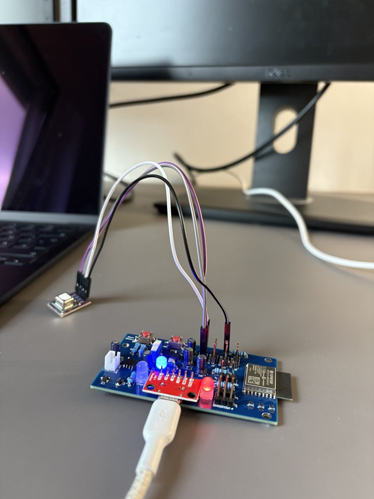

# Sensor Hub: ESP32, FastAPI, Postgres, and Docker

[](https://github.com/m-hoelper/sensor-hub/actions/workflows/ci.yml)

Sensor Hub monitors the air in my room. An ESP32-S3 with a Sensirion SCD40 measures CO₂, temperature, and humidity. It stores every reading in flash and uploads the readings to a FastAPI backend. The backend stores the data in Postgres and shows it in Grafana. When the window should be opened or closed, the backend sends a Telegram message. One `docker compose up` starts the whole backend.

I built it in November 2026 as a personal project. The firmware is C++ on Arduino-ESP32, the backend is Python, and Docker Compose runs the backend.

I wrote the backend and firmware code myself, with an AI assistant (Claude) as tutor and reviewer. The test suite, the Telegram sender, the Grafana dashboard, the Docker setup, and this documentation were written with the assistant and reviewed by me.

The main features are:

- **No data loss while the backend is offline.** The ESP32 keeps up to one week of readings in a ring buffer in flash. When the server answers again, the ESP32 uploads the backlog in batches.
- **Idempotent batch upload.** Each reading is unique per `(device_id, created_at)`. If the ESP32 resends a batch after a lost response, Postgres stores no row twice (`INSERT ... ON CONFLICT DO NOTHING RETURNING`).
- **Notifications through an outbox.** The window rule writes a notification row in the same transaction as the measurements. A separate worker sends the row to Telegram, with retries and `SELECT ... FOR UPDATE SKIP LOCKED`.
- **Window rule with hysteresis.** The rule uses separate open and close thresholds for CO₂ and humidity. You change the thresholds at runtime through the API.
- **Least privilege.** All write endpoints need an API key. Grafana reads Postgres through a read-only role. Secrets come from `.env` at runtime and are never in the image or in git.

The other documents cover these topics:

- [ARCHITECTURE.md](docs/ARCHITECTURE.md) describes the firmware, the API, the window rule, the worker, and the failure behavior.
- [DESIGN.md](docs/DESIGN.md) explains the design decisions and the alternatives I rejected.
- [RUNNING.md](docs/RUNNING.md) shows how to start the backend, flash the firmware, and run the tests.

<p align="center">
  <br>
  <em>One afternoon in Grafana. Each orange marker is a Telegram message. At 13:53, CO₂ passes 1000 ppm and the message says "open".<br>
  Airing from 15:40 lowers CO₂ and temperature, and at 15:44 the message says "close". CO₂ rises again, and at 16:16 the message says "open". The dashed lines are the open and close thresholds.</em>
</p>

| The same messages on my phone | The device: ESP32-S3 and SCD40 | The board, hand-soldered in the lab |
|:---:|:---:|:---:|
|  |  |  |

## Each part has one job

| Part | Job |
|---|---|
| ESP32-S3 and SCD40 | Reads the sensor every second, averages over 30 s, stores each average as a 16-byte record in a flash ring buffer, and uploads the oldest 500 records or fewer per request. |
| FastAPI | Validates and stores batches, answers queries for the latest reading, lists, and statistics, and runs the window rule on the newest fresh reading. |
| Postgres | Stores measurements, threshold settings, and the notification outbox. Alembic manages the schema. |
| Redis | Caches the latest reading per device for 60 s. A write deletes the cached reading. The API keeps working when Redis is down. |
| Worker | Polls unsent notifications and sends them to Telegram, with up to 5 attempts for each notification. |
| Grafana | Shows CO₂, humidity, and temperature on a dashboard that is provisioned from files in this repository. |

## The sensor keeps measuring when the backend is off

```
 ESP32-S3 + SCD40 (always on, USB power)                    Mac: Docker Compose (when it is on)
 ┌──────────────────────────────────────┐                  ┌──────────────────────────────────────────────┐
 │ sample every 1 s, average over 30 s  │                  │ api (FastAPI) ──► Postgres ◄── Grafana         │
 │ → ring buffer in flash (1 week)      │  POST            │   │  ON CONFLICT DO NOTHING      (read-only role)│
 │ backlog > 0: send oldest ≤ 500  ─────┼─ /measurements ─►│   │  window rule, same commit                 │
 │ 2xx: drop them · error: retry in 30 s│  X-API-Key       │   ├──► Redis (latest-reading cache)            │
 │ time: NTP, UTC                       │ ◄── 201 ─────────┤   └──► notifications (outbox) ──► worker ──► Telegram
 └──────────────────────────────────────┘ {inserted, dup.} └──────────────────────────────────────────────┘
```

The backend has to run only when I want live data or notifications. Readings taken while it is off keep their original timestamps and arrive when the API answers again.

## Window rule and thresholds

The rule has two states, `CLOSED` and `OPEN_RECOMMENDED`. High CO₂ or high humidity moves the state to `OPEN_RECOMMENDED`. Low CO₂ and low humidity move it back to `CLOSED`. The gap between the open and close thresholds stops the state from switching back and forth around one value.

The rule runs once per batch on the newest reading. A reading older than 5 minutes triggers nothing, so an uploaded backlog sends no old messages. You change the thresholds with `PATCH /settings/thresholds`. [ARCHITECTURE.md](docs/ARCHITECTURE.md#window-rule) lists every transition and threshold. [DESIGN.md](docs/DESIGN.md#threshold-values) explains how I tuned the thresholds with real data.

## API

| Method | Path | Needs the API key | Purpose |
|---|---|---|---|
| `POST` | `/measurements` | Yes | Uploads a batch of 1 to 500 readings and returns `{inserted, duplicates}`. |
| `GET` | `/measurements` | No | Lists readings, newest first. Takes `device_id`, `limit`, and `offset`. |
| `GET` | `/measurements/latest` | No | Returns the newest reading from the Redis cache. |
| `GET` | `/measurements/stats` | No | Returns count, average, minimum, and maximum CO₂ in a time range. |
| `GET` | `/measurements/{id}` | No | Returns one reading. |
| `DELETE` | `/measurements/{id}` | Yes | Deletes one reading. |
| `GET` | `/settings/thresholds` | No | Returns the current thresholds. |
| `PUT` | `/settings/thresholds` | Yes | Replaces all thresholds. |
| `PATCH` | `/settings/thresholds` | Yes | Changes some thresholds. |
| `GET` | `/notifications` | No | Lists sent and pending messages. |
| `GET` | `/notifications/state` | No | Returns the current window state. |

`PUT` and `PATCH` reject thresholds unless close is below open and open is below max. When the stack runs, the interactive API docs are at `http://localhost:8000/docs`.

## Start the backend

```bash
cp .env.example .env
docker compose up -d --build
scripts/create_grafana_role.sh
```

Fill in the API key and the database passwords in `.env` before you start. The Telegram token is optional. The last command creates the read-only Postgres role for Grafana. You run it once.

- The API docs are at `http://localhost:8000/docs`, and the dashboard is at `http://localhost:3000`.
- If you have no hardware, run `uv run python scripts/simulator.py`. It sends random readings in the same format as the ESP32.
- To flash the firmware, copy `firmware/include/secrets.example.h` to `secrets.h`, fill in Wi-Fi, the API key, and the backend URL, and flash it with PlatformIO.

[RUNNING.md](docs/RUNNING.md) has the details, the test setup, and the day-to-day commands.

## Repository layout

```
src/sensor_hub/
  main.py                    FastAPI app
  routes/                    measurements, settings, notifications
  services.py                business logic: batch insert, rule call, cache
  repositories.py            SQLAlchemy queries
  rules.py                   window state machine and message text
  worker.py, telegram.py     outbox worker and Telegram sender
  models.py, schemas.py      database tables and Pydantic models
  config.py, cache.py, db.py settings from the environment, Redis, sessions
migrations/                  Alembic migrations
tests/                       pytest suite against a real Postgres test database
firmware/                    PlatformIO project for the ESP32-S3 (src/main.cpp)
grafana/                     provisioned data source and dashboard
scripts/                     simulator, Grafana role, Telegram chat ID helper
docs/                        architecture, design decisions, run notes, media
Dockerfile, docker-compose.yaml
```

## Tech stack

| Area | Tools |
|---|---|
| Firmware | C++ on Arduino-ESP32, PlatformIO, Sensirion SCD4x driver, ArduinoJson, LittleFS, NTP |
| Backend | Python 3.12, FastAPI, Pydantic v2, SQLAlchemy 2, Alembic, psycopg 3, redis-py, httpx |
| Data | PostgreSQL 17, Redis 7, Grafana 11 |
| Tooling | uv, pytest, Docker, Docker Compose |

## Tests

The suite has 153 pytest tests. They run against a real Postgres test database at `TEST_DATABASE_URL`. Fakes replace the Redis cache and the Telegram API. The tests cover batch validation, duplicate handling, the rule transitions, the cache fallback, threshold validation, and the retry and locking behavior of the worker. On every push, GitHub Actions runs the tests, builds the Docker image, and builds the firmware.

```bash
uv run pytest
```

To count the tests, run `uv run pytest --collect-only -q | tail -1`.

## Known limitations

- Notifications arrive only while the backend runs. The readings themselves are not lost.
- All devices share one API key, and the key travels over plain HTTP on the home network. That is acceptable at home or over a VPN. On the internet, the API needs HTTPS and one key per device.
- The rule does not know whether the window is open. It knows only what it recommended.
- Postgres keeps every reading. At one reading every 30 s, that is about 100 MB per year.
- The firmware has no automated tests. I tested it on the device.

## License

MIT, see [LICENSE](LICENSE).
